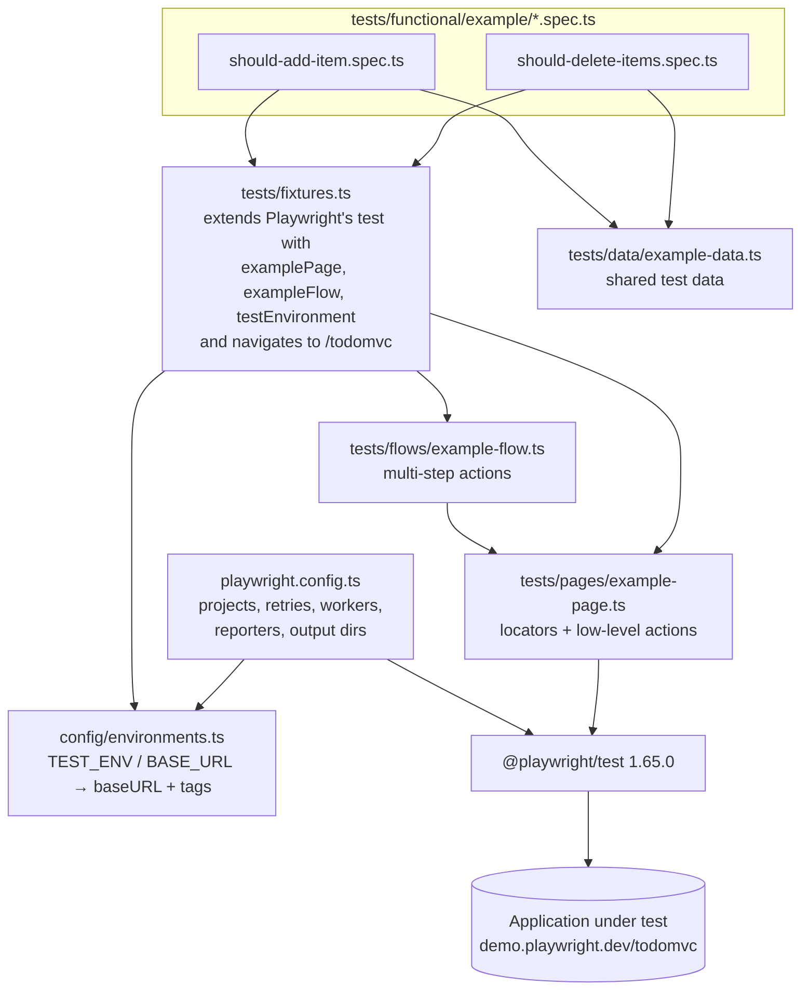
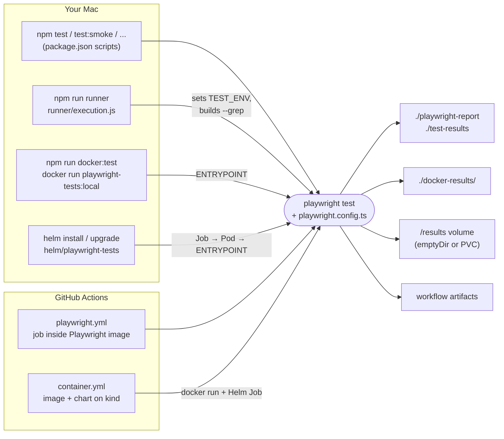
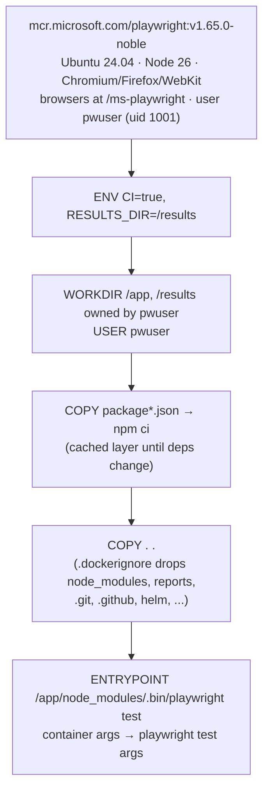
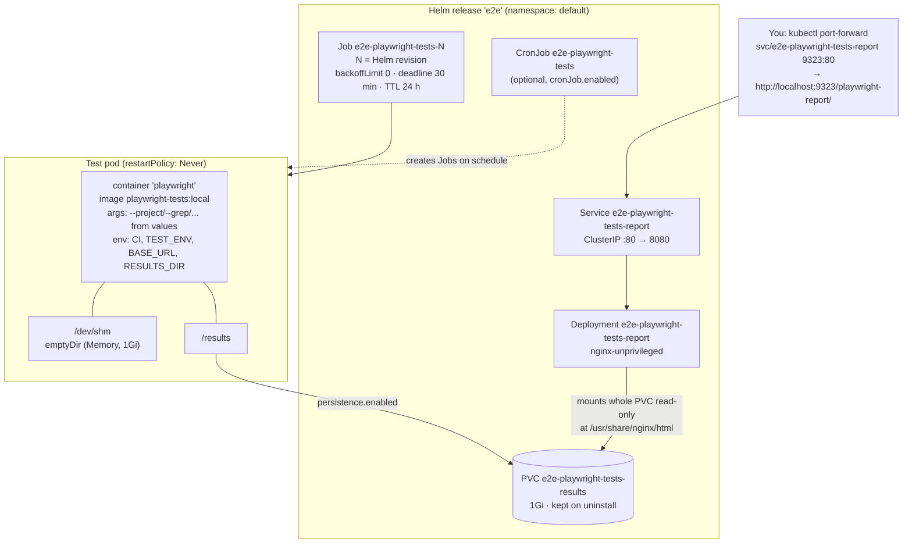
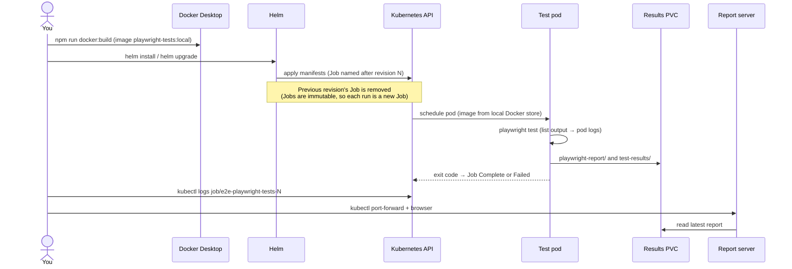
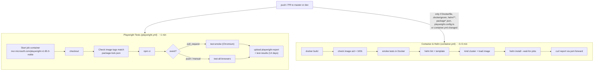

# Project Guide

The complete reference for this Playwright end-to-end test framework: what it is, how it's built, where everything lives, and how to install, start, run, and shut down every part of it — locally, in Docker, on Kubernetes with Helm, and in GitHub Actions.

For a shorter introduction, see the [README](../README.md).

## Contents

1. [Overview](#1-overview)
2. [Versions](#2-versions)
3. [Architecture](#3-architecture)
4. [Repository layout](#4-repository-layout)
5. [Where things are stored](#5-where-things-are-stored)
6. [Configuration](#6-configuration)
7. [Installation](#7-installation)
8. [Starting everything](#8-starting-everything)
9. [Running tests](#9-running-tests)
10. [Viewing results](#10-viewing-results)
11. [Shutting everything down](#11-shutting-everything-down)
12. [Continuous integration](#12-continuous-integration)
13. [Helm chart reference](#13-helm-chart-reference)
14. [Upgrading Playwright](#14-upgrading-playwright)
15. [Troubleshooting](#15-troubleshooting)
16. [Extending the framework](#16-extending-the-framework)
17. [Command cheat sheet](#17-command-cheat-sheet)

---

## 1. Overview

A reusable Playwright test automation template. The bundled `example` domain tests the public [TodoMVC demo](https://demo.playwright.dev/todomvc) (add and delete todos), so everything works out of the box; you replace it with your own application's pages and specs.

The same test suite runs in five ways:

| Mode | Where it runs | Typical use |
| ---- | ------------- | ----------- |
| **Local** (`npm test`) | Directly on your Mac, using browsers in `~/Library/Caches/ms-playwright` | Writing and debugging tests |
| **Framework runner** (`npm run runner`) | Same as local, with a friendlier CLI for env/browser/tags | Day-to-day selective runs |
| **Docker** (`npm run docker:test`) | A container built from the official Playwright image | Reproducible runs, same environment as CI and Kubernetes |
| **Kubernetes** (Helm chart) | A `Job` (or scheduled `CronJob`) in a cluster — locally, Docker Desktop's built-in Kubernetes | Running the suite as a deployable workload, on a schedule, or against in-cluster apps |
| **GitHub Actions** | Inside the official Playwright image on GitHub's runners | Every push and pull request |

Key design points:

- **Page Object Model + flows + fixtures**: specs never touch raw locators; they request page objects and flows as Playwright fixtures.
- **Per-environment config**: `TEST_ENV` picks a base URL (`demo`, `dev`, `qa`, `uat`); `BASE_URL` overrides it.
- **Tags on three axes** (environment, suite, domain) so any subset can be run.
- **One image everywhere**: Docker, Kubernetes and CI all use `mcr.microsoft.com/playwright:v1.65.0-noble`, which bundles the browsers and their OS libraries — nothing is downloaded at run time.

---

## 2. Versions

### Project dependencies (from `package-lock.json`)

| Package | Version | Notes |
| ------- | ------- | ----- |
| `@playwright/test` | 1.65.0 | Test runner + browser automation |
| `typescript` | 7.0.2 | Only for `npm run typecheck`; Playwright transpiles tests itself |
| `@types/node` | 26.2.0 | |

### Container images

| Image | Tag | Used by |
| ----- | --- | ------- |
| `mcr.microsoft.com/playwright` | `v1.65.0-noble` (Ubuntu 24.04, Node 26.13.0) | `Dockerfile` base image; GitHub Actions test job container |
| `playwright-tests` | `local` (built by `npm run docker:build`, ~3.7 GB) | Docker runs and the local Kubernetes cluster |
| `nginxinc/nginx-unprivileged` | `1.31-alpine` | Helm chart's optional report server |

Browser builds bundled with Playwright 1.65.0: Chromium 1254, Firefox 1572, WebKit 2388.

### Local tooling (as set up on this Mac)

| Tool | Version | Installed via |
| ---- | ------- | ------------- |
| macOS | 27.2.1 (Apple Silicon, arm64) | |
| Node.js / npm | 24.19.0 / 12.2.2 | |
| Docker Desktop | 4.99.0 (Engine 29.9.3) | Docker Desktop installer |
| Kubernetes | 1.36.1, single-node **kubeadm** cluster | Docker Desktop → Kubernetes |
| kubectl | 1.36.1 | Bundled with Docker Desktop |
| Helm | 4.3.1 | `brew install helm` |
| Homebrew | 7.0.13 | |

### GitHub Actions

| Item | Version |
| ---- | ------- |
| Runner | `ubuntu-latest` (Ubuntu 24.04 at time of writing) |
| `actions/checkout` | v7 (Node 24 runtime) |
| `actions/upload-artifact` | v7 (Node 24 runtime) |
| Helm / kind / kubectl on runner | Preinstalled by GitHub (3.22.1 / 0.33.0 / 1.37.2 at time of writing) |

> Local Node (24.x) and the image's Node (26.x) differ. That's fine for this suite; if a test ever depends on Node behaviour, trust the Docker/CI result.

---

## 3. Architecture

### 3.1 Test framework layers

Specs describe *what* to test; everything below them describes *how*. Each layer only talks to the one beneath it.



### 3.2 Ways the suite is launched

All five modes end up calling `playwright test` with the same config; they differ in where the browsers come from and where results go.



### 3.3 Docker image



### 3.4 Kubernetes deployment (Helm chart)

What `helm install e2e helm/playwright-tests --set persistence.enabled=true --set reportServer.enabled=true` creates:



### 3.5 Lifecycle of a Kubernetes test run



### 3.6 CI pipelines



---

## 4. Repository layout

```
.
├── .claude/
│   ├── settings.local.json        # Claude Code permissions for this repo
│   └── skills/                    # Claude Code skills: playwright-cli, playwright-test-patterns, playwright-trace
├── .github/workflows/
│   ├── playwright.yml             # Main CI: tests inside the Playwright image
│   └── container.yml              # Docker image + Helm chart checks on a kind cluster
├── config/
│   └── environments.ts            # demo/dev/qa/uat base URLs + environment tags
├── docs/
│   └── PROJECT_GUIDE.md           # This guide
├── helm/playwright-tests/         # Helm chart
│   ├── Chart.yaml                 # chart 0.1.0, appVersion 1.65.0
│   ├── values.yaml                # all settings (see §13)
│   └── templates/
│       ├── _helpers.tpl           # names, labels, shared pod template
│       ├── job.yaml               # one-off run per install/upgrade
│       ├── cronjob.yaml           # optional scheduled runs
│       ├── pvc.yaml               # optional results volume
│       ├── report-server.yaml     # optional nginx Deployment + Service
│       └── NOTES.txt              # post-install instructions
├── runner/
│   └── execution.js               # CLI wrapper: --env --browser --tags --headed --ui
├── specs/
│   └── example.plan.md            # Test plan the example specs implement
├── tests/
│   ├── fixtures.ts                # custom fixtures (page objects, flows, environment)
│   ├── pages/example-page.ts      # Page Object
│   ├── flows/example-flow.ts      # multi-step actions
│   ├── data/example-data.ts       # shared test data
│   ├── functional/example/        # spec files
│   ├── _seed/seed.spec.ts         # starting-state reference (ignored by the runner)
│   └── support/tags.md            # tag vocabulary
├── .dockerignore                  # keeps node_modules, reports, .git, helm, ... out of the image
├── .gitignore
├── Dockerfile                     # test-runner image
├── package.json / package-lock.json
├── playwright.config.ts
├── tsconfig.json                  # for `npm run typecheck` only
└── README.md
```

---

## 5. Where things are stored

### Test output

| Mode | HTML report | Traces / screenshots (`test-results`) | Console output |
| ---- | ----------- | -------------------------------------- | -------------- |
| Local / runner | `./playwright-report/` | `./test-results/` | Terminal (default `html` reporter prints a summary) |
| Docker (`npm run docker:test`) | `./docker-results/playwright-report/` | `./docker-results/test-results/` | Terminal (`list` reporter) |
| Kubernetes, default | `/results` in the pod — an `emptyDir`, **lost when the pod is deleted** | same | `kubectl logs job/...` |
| Kubernetes, `persistence.enabled` | PVC `<release>-playwright-tests-results` → `playwright-report/` | same PVC → `test-results/` | `kubectl logs job/...` |
| GitHub Actions | Artifact `playwright-report` (kept 14 days) | Artifact `test-results` (14 days) | Job log + `github` reporter annotations |

All of these output folders are git-ignored. Each run wipes and rewrites its own report and `test-results` folders.

### Everything else

| What | Where |
| ---- | ----- |
| Browsers for local runs | `~/Library/Caches/ms-playwright/` (`npx playwright install`) |
| Browsers in Docker / CI / Kubernetes | Inside the image at `/ms-playwright` |
| Node dependencies | `./node_modules/` locally; `/app/node_modules` in the image |
| Built test image | Docker Desktop's image store (`docker image ls playwright-tests`) |
| Docker Desktop settings | `~/Library/Group Containers/group.com.docker/settings-store.json` |
| Kubernetes credentials / context | `~/.kube/config`, context `docker-desktop` |
| Helm release history | Secrets in the release namespace (`kubectl get secrets -l owner=helm`) |
| PVC data | Docker Desktop's `hostpath` storage class, inside the Docker Desktop VM |
| Helm binary | `/opt/homebrew/bin/helm` |
| Local session junk from Playwright tooling | `.playwright/`, `.playwright-cli/`, `.playwright-mcp/`, `videos/` (all git-ignored) |

---

## 6. Configuration

### Environment variables

| Variable | Read by | Effect |
| -------- | ------- | ------ |
| `TEST_ENV` | `config/environments.ts` | `demo` (default), `dev`, `qa`, `uat` → base URL + environment tags. Unknown values throw. |
| `BASE_URL` | `config/environments.ts` | Overrides the environment's base URL. |
| `CI` | `playwright.config.ts` | Truthy → `forbidOnly`, 2 retries, 1 worker, plus a console reporter. Set automatically in Docker, Kubernetes and GitHub Actions. |
| `GITHUB_ACTIONS` | `playwright.config.ts` | Set by GitHub → adds the `github` annotations reporter. |
| `RESULTS_DIR` | `playwright.config.ts` | Moves `playwright-report/` and `test-results/` under this folder. The image sets it to `/results`. |

### Environments (`config/environments.ts`)

| `TEST_ENV` | Base URL | Tag |
| ---------- | -------- | --- |
| `demo` | `https://demo.playwright.dev` (working example) | `@demo_env` |
| `dev` | `https://dev.example.com` (placeholder) | `@dev_env` |
| `qa` | `https://qa.example.com` (placeholder) | `@qa_env` |
| `uat` | `https://uat.example.com` (placeholder) | `@uat_env` |

### What `playwright.config.ts` does in each context

| Setting | Local | Docker / Kubernetes | GitHub Actions |
| ------- | ----- | ------------------- | -------------- |
| Retries | 0 | 2 | 2 |
| Workers | CPU-based | 1 (override with `--workers` / `tests.workers`) | 1 |
| `test.only` allowed | yes | no | no |
| Reporters | `html` (opens on failure) | `html` + `list` | `html` + `github` |
| Trace | on first retry | on first retry | on first retry |
| Projects | chromium, firefox, webkit | same | same |
| Ignored | `tests/_seed/**` | same | same |

### Tags

| Axis | Tags |
| ---- | ---- |
| Environment | `@demo_env`, `@dev_env`, `@qa_env`, `@uat_env` |
| Suite | `@smoke`, `@functional` |
| Domain (example) | `@example`, `@add`, `@delete`, `@single`, `@multiple` |

Current suite: 2 tests × 3 browsers = 6 runs. Only "should add single item" is tagged `@smoke`.

---

## 7. Installation

### 7.1 Local test development (required)

```bash
npm install
```

```bash
npx playwright install
```

The second command downloads Chromium, Firefox and WebKit into `~/Library/Caches/ms-playwright/`. Verify with:

```bash
npm run typecheck && npm run test:smoke
```

### 7.2 Docker (optional)

1. Install [Docker Desktop](https://www.docker.com/products/docker-desktop/) and start it.
2. Build the image:

   ```bash
   npm run docker:build
   ```

### 7.3 Kubernetes and Helm (optional)

1. **Turn on Kubernetes in Docker Desktop**: Docker Desktop → **Kubernetes** (sidebar) → **Create cluster** → choose **Kubeadm** → **Create** → **Install**. It takes about a minute.
   - Pick **Kubeadm**, not kind: with kubeadm the cluster uses Docker Desktop's image store, so the locally built `playwright-tests:local` image is available without a registry.
2. **Install Helm**:

   ```bash
   brew install helm
   ```

3. **Check the cluster**:

   ```bash
   kubectl config use-context docker-desktop
   ```

   ```bash
   kubectl get nodes
   ```

   You should see one `docker-desktop` node in `Ready` state.

---

## 8. Starting everything

From a cold start (Mac rebooted or Docker Desktop quit):

1. **Start Docker Desktop** (Kubernetes starts with it if enabled):

   ```bash
   docker desktop start
   ```

   or open Docker Desktop from Applications. Check it with:

   ```bash
   docker desktop status
   ```

2. **Wait for Kubernetes** (only if you use it):

   ```bash
   kubectl wait --for=condition=Ready node --all --timeout=180s
   ```

   Kubernetes starts on its own with Docker Desktop as long as it's switched on; quitting or restarting Docker Desktop doesn't change that. If this reports `connection refused`, check `docker desktop kubernetes status`. `disabled` means Kubernetes was switched off in Docker Desktop (Settings → Kubernetes, or stopped from the Kubernetes page), and the Kubernetes page offers **Create cluster** again. Click it, keep **Kubeadm**, then **Create** → **Install**. This switches the existing cluster back on (same node, Helm releases and saved results); it does not start from scratch. Only **Reset cluster** wipes it.

3. **Rebuild the image** if tests, config or dependencies changed since the last build:

   ```bash
   npm run docker:build
   ```

There are no long-running services to start for local or Docker runs. Helm releases and PVCs survive a Docker Desktop restart, and also Kubernetes being switched off and on again. Both were checked: release `e2e`, its PVC and the saved report were intact each time, and after `docker desktop restart` the cluster was running again within about 20 seconds. The report server pod restarts with the cluster and serves the same report.

---

## 9. Running tests

### 9.1 Locally

```bash
npm test                          # Chromium, full suite
npm run test:all-browsers         # Chromium + Firefox + WebKit
npm run test:smoke                # @smoke, Chromium
npm run test:functional           # @functional, Chromium
npm run test:tag -- @delete       # any tag, Chromium
npm run test:headed               # visible browser
npm run test:ui                   # Playwright UI mode
TEST_ENV=qa npm test              # another environment
BASE_URL=https://staging.example.com npm test
```

### 9.2 Framework runner

```bash
npm run runner -- --env demo --browser firefox --tags smoke,example
```

| Flag | Values | Default |
| ---- | ------ | ------- |
| `--env` | `demo`, `dev`, `qa`, `uat` | `demo` |
| `--browser` | `chromium`, `firefox`, `webkit` (one) | `chromium` |
| `--tags` | comma-separated, **AND** semantics | none |
| `--headed` / `--ui` | flags | off |

### 9.3 Docker

```bash
npm run docker:test                                        # full suite, all browsers
npm run docker:test -- --project chromium --grep @smoke    # args go to `playwright test`
TEST_ENV=qa npm run docker:test                            # TEST_ENV / BASE_URL are passed through
```

Plain `docker run` equivalent:

```bash
docker run --rm --ipc=host -e TEST_ENV=demo -v "$PWD/docker-results:/results" playwright-tests:local --project webkit
```

`--ipc=host` gives Chromium enough shared memory; without it large pages can crash the browser.

### 9.4 Kubernetes with Helm

**First run** (creates release `e2e`, Job `e2e-playwright-tests-1`):

```bash
helm install e2e helm/playwright-tests \
  --set 'tests.projects={chromium}' \
  --set tests.grep=@smoke \
  --set persistence.enabled=true \
  --set reportServer.enabled=true
```

**Follow the run and check the result:**

```bash
kubectl logs -f job/e2e-playwright-tests-1
```

```bash
kubectl get jobs -l app.kubernetes.io/instance=e2e
```

`Complete` = all tests passed; `Failed` = Playwright exited non-zero.

**Run again** (new revision → new Job `e2e-playwright-tests-2`, the old Job is removed):

```bash
helm upgrade e2e helm/playwright-tests --reuse-values
```

**Change settings on a re-run:**

```bash
helm upgrade e2e helm/playwright-tests --reuse-values --set 'tests.projects={}' --set tests.grep=""
```

- `tests.projects={}` means "all browsers". Don't use `tests.projects=null` with `--reuse-values` — Helm keeps the old value.

**Wait for the run in scripts** (exits non-zero if tests fail):

```bash
helm upgrade e2e helm/playwright-tests --reuse-values --wait --wait-for-jobs --timeout 10m
```

**Scheduled runs:**

```bash
helm upgrade e2e helm/playwright-tests --reuse-values --set cronJob.enabled=true --set cronJob.schedule="0 6 * * *"
```

```bash
kubectl create job --from=cronjob/e2e-playwright-tests e2e-manual-$(date +%s)
```

**App credentials**: put them in a Secret and pass it with `envFrom`, e.g. in a values file:

```yaml
envFrom:
  - secretRef:
      name: playwright-test-credentials
```

**Another cluster**: push the image to a registry the cluster can reach, then set `image.repository`, `image.tag` and, for a private registry, `imagePullSecrets`.

### 9.5 GitHub Actions

Runs automatically on pushes and PRs to `master`/`dev`. To start one by hand (optionally against another environment):

```bash
gh workflow run playwright.yml --ref dev -f env=qa
```

```bash
gh run watch
```

---

## 10. Viewing results

| Mode | How |
| ---- | --- |
| Local | `npm run test:report` |
| Docker | `npx playwright show-report docker-results/playwright-report` |
| Kubernetes | `kubectl port-forward svc/e2e-playwright-tests-report 9323:80`, then open http://localhost:9323/playwright-report/ (needs `persistence` + `reportServer`). Stop with Ctrl-C. |
| GitHub Actions | Run page → **Artifacts** → `playwright-report`; unzip, then `npx playwright show-report <folder>` |

**Traces** (recorded on the first retry of a failing test) appear inside the HTML report, or open one directly:

```bash
npx playwright show-trace test-results/<test-folder>/trace.zip
```

---

## 11. Shutting everything down

Do these in order; stop wherever you like.

1. **Stop a port-forward**: Ctrl-C in its terminal.
2. **Remove the Helm release** (Jobs, CronJob, report server, Service):

   ```bash
   helm uninstall e2e
   ```

3. **Delete the saved results** (the PVC is kept on uninstall on purpose):

   ```bash
   kubectl delete pvc e2e-playwright-tests-results
   ```

4. **Stop Docker Desktop** (stops the Docker engine and Kubernetes; nothing is deleted):

   ```bash
   docker desktop stop
   ```

   This is all you need to free up resources. Leave Kubernetes switched on in Docker Desktop and it will start again by itself next time.

Optional clean-up:

| To | Run |
| -- | --- |
| Remove the test image (~3.7 GB) | `docker image rm playwright-tests:local` |
| Remove the `alpine/helm` image (used once to lint the chart before Helm was installed) | `docker image rm alpine/helm:3.22.1` |
| Clear local test output | `rm -rf playwright-report test-results docker-results` |
| Remove local browsers | `rm -rf ~/Library/Caches/ms-playwright` |
| Remove the whole Kubernetes cluster | Docker Desktop → Kubernetes → **Reset cluster**, or disable Kubernetes in Settings |
| Uninstall Helm | `brew uninstall helm` |

---

## 12. Continuous integration

| Workflow | Triggers | What it proves | Typical time |
| -------- | -------- | -------------- | ------------ |
| **Playwright Tests** (`playwright.yml`) | Every push/PR to `master`/`dev`; manual with an `env` choice | PRs: `@smoke` on Chromium. Pushes/manual: full suite on all browsers. | ~1 min |
| **Container & Helm** (`container.yml`) | Push/PR touching `Dockerfile`, `.dockerignore`, `helm/**`, `package*.json`, `playwright.config.ts` or the workflow; manual | Image builds, runs as uid 1001, smoke passes in Docker, chart lints, chart installs on kind, Job completes, report server serves the report | ~3–5 min |

Notes:

- The test job runs **inside** `mcr.microsoft.com/playwright:v1.65.0-noble`, so it does not download browsers or `apt-get install` anything. (It used to; GitHub's Ubuntu mirror stalled in November 2026 and broke CI, which is why this changed.)
- The first step of `playwright.yml` fails if the image tag in the workflow or the `Dockerfile` differs from `@playwright/test` in `package-lock.json`.
- Branch flow used so far: work on `dev`, push, let CI pass, then fast-forward `master` to `dev`.

---

## 13. Helm chart reference

Chart `helm/playwright-tests`, version 0.1.0. All values, from `values.yaml`:

| Value | Default | Purpose |
| ----- | ------- | ------- |
| `image.repository` / `image.tag` / `image.pullPolicy` | `playwright-tests` / `local` / `IfNotPresent` | Test image |
| `imagePullSecrets` | `[]` | For private registries |
| `tests.env` | `demo` | `TEST_ENV` |
| `tests.baseURL` | `""` | `BASE_URL` override |
| `tests.projects` | `[]` (all) | Each entry → `--project=<name>`; empty entries ignored |
| `tests.grep` / `tests.grepInvert` | `""` | `--grep` / `--grep-invert`; for AND use `(?=.*@smoke)(?=.*@example)` |
| `tests.workers` | `""` | `--workers` |
| `tests.extraArgs` | `[]` | Any other `playwright test` flags, e.g. `--shard=1/2` |
| `extraEnv` / `envFrom` | `[]` | Extra variables / Secrets and ConfigMaps |
| `job.enabled` | `true` | One-off Job per install/upgrade |
| `job.backoffLimit` | `0` | Playwright retries tests itself; don't rerun the pod |
| `job.activeDeadlineSeconds` | `1800` | Kill the run after 30 minutes |
| `job.ttlSecondsAfterFinished` | `86400` | Delete finished Jobs after 24 h |
| `cronJob.enabled` / `schedule` / `timeZone` | `false` / `0 6 * * *` / `""` | Scheduled runs |
| `cronJob.concurrencyPolicy` | `Forbid` | Never overlap runs |
| `cronJob.successfulJobsHistoryLimit` / `failedJobsHistoryLimit` | `3` / `3` | |
| `cronJob.suspend` | `false` | Pause the schedule |
| `persistence.enabled` / `size` / `storageClass` / `accessModes` | `false` / `1Gi` / default / `[ReadWriteOnce]` | Results PVC (kept on uninstall) |
| `reportServer.enabled` | `false` | nginx serving the PVC; **requires `persistence.enabled`** (install fails otherwise) |
| `reportServer.image.*` | `nginxinc/nginx-unprivileged:1.31-alpine` | |
| `reportServer.podSecurityContext` | uid/gid 101 | nginx's own user |
| `reportServer.service.type` / `port` | `ClusterIP` / `80` | |
| `resources` | requests 1 CPU / 1Gi, limit 2Gi memory | Test container |
| `shmSize` | `1Gi` | `/dev/shm` for the browsers |
| `podSecurityContext` | non-root, uid/gid/fsGroup 1001 | Matches `pwuser` in the image (checked in CI) |
| `securityContext` | no privilege escalation, all capabilities dropped | |
| `nodeSelector` / `tolerations` / `affinity` / `podAnnotations` / `podLabels` | empty | Scheduling and metadata |

Resource names (release `e2e`): Job `e2e-playwright-tests-<revision>`, CronJob `e2e-playwright-tests`, PVC `e2e-playwright-tests-results`, Deployment and Service `e2e-playwright-tests-report`. If the release name already contains `playwright-tests`, the prefix is just the release name.

Preview what the chart will create without installing:

```bash
helm template e2e helm/playwright-tests --set persistence.enabled=true --set reportServer.enabled=true
```

---

## 14. Upgrading Playwright

1. Bump the package:

   ```bash
   npm install -D @playwright/test@<new-version>
   ```

2. Update the image tag to the same version in **both** `Dockerfile` (`FROM`) and `.github/workflows/playwright.yml` (`container.image`). Confirm the tag exists at `mcr.microsoft.com/playwright:v<new-version>-noble`.
3. Update `appVersion` in `helm/playwright-tests/Chart.yaml` (cosmetic, but keeps labels honest).
4. Refresh local browsers and the image:

   ```bash
   npx playwright install
   ```

   ```bash
   npm run docker:build
   ```

5. Run `npm run typecheck && npm run test:all-browsers` and `npm run docker:test`, then push to `dev`. CI fails with a clear message if step 2 was missed.

---

## 15. Troubleshooting

| Symptom | Cause | Fix |
| ------- | ----- | --- |
| `Cannot connect to the Docker daemon` / `docker.sock: no such file` | Docker Desktop isn't running | `docker desktop start` |
| `kubectl`: `connection refused` on `127.0.0.1:6443`, or `helm`: `kubernetes cluster unreachable` | Docker Desktop (and its cluster) stopped, or Kubernetes disabled | Start Docker Desktop; check `docker desktop kubernetes status` |
| `docker desktop kubernetes status` says `disabled`; the Kubernetes page shows **Create cluster** | Kubernetes was switched off in Docker Desktop (Settings → Kubernetes, or stopped from the Kubernetes page). Quitting or restarting Docker Desktop does not do this. | **Create cluster** → **Kubeadm** → **Create** → **Install**. The existing cluster, releases and PVCs come back. Avoid **Reset cluster**, which wipes them. |
| `current-context is not set` | No cluster context selected | `kubectl config use-context docker-desktop` |
| Pod stuck in `ErrImagePull` / `ImagePullBackOff` | Image not built, or the cluster can't see local images (kind cluster type, or a remote cluster) | `npm run docker:build`; use the Kubeadm cluster type; or push to a registry and set `image.*` |
| Job `Failed` immediately with `Project(s) "" not found` | An empty project name reached Playwright (fixed in the chart; seen with old chart versions) | Use the current chart; `--set 'tests.projects={}'` means all browsers |
| `helm upgrade --set tests.projects=null --reuse-values` doesn't clear the list | Helm keeps reused values when set to null | Use `--set 'tests.projects={}'` |
| `reportServer.enabled requires persistence.enabled=true` | Guard in the chart | Add `--set persistence.enabled=true` |
| Job pod `Pending` with a PVC on a multi-node cluster | `ReadWriteOnce` volume already mounted by the report server on another node | Use a `ReadWriteMany` storage class, or disable the report server |
| Report server shows an old or empty report | Run hasn't finished, or persistence is off | Check the Job finished; enable `persistence` |
| Chromium crashes ("Target closed", "page crashed") in Docker | Not enough shared memory | Use `--ipc=host` (the npm script does); in Kubernetes raise `shmSize` |
| `EACCES` writing `docker-results/` on a Linux host | Container runs as uid 1001 | `chmod 777 docker-results` or run with `--user "$(id -u)"` |
| CI: "Playwright image is vX but package-lock.json has Y" | Tags drifted during an upgrade | See [§14](#14-upgrading-playwright) |
| CI: `Executable doesn't exist at /ms-playwright/...` | Image version doesn't match `@playwright/test` | Same as above |
| `Unsupported TEST_ENV "x"` | Typo in the environment name | Use `demo`, `dev`, `qa` or `uat`, or add a new one in `config/environments.ts` |
| Tests pass locally but fail against `dev`/`qa`/`uat` | Those URLs are placeholders | Point them at your real environments in `config/environments.ts` |

Useful diagnostics:

```bash
kubectl describe job e2e-playwright-tests-<revision>
```

```bash
kubectl get events --sort-by=.lastTimestamp | tail -20
```

```bash
helm history e2e
```

```bash
helm get values e2e
```

---

## 16. Extending the framework

To test a new area of your application (say `cart`), copy the `example` pattern:

| Step | File | Contents |
| ---- | ---- | -------- |
| 1 | `tests/pages/cart-page.ts` | Page Object: locators (prefer `getByRole` / `getByTestId`) and low-level actions |
| 2 | `tests/flows/cart-flow.ts` (optional) | Multi-step actions built from page objects |
| 3 | `tests/data/cart-data.ts` | Shared test data |
| 4 | `tests/fixtures.ts` | Register `cartPage` / `cartFlow` so specs can request them |
| 5 | `specs/cart.plan.md` | Scenarios and expected outcomes |
| 6 | `tests/functional/cart/*.spec.ts` | Specs with `// spec:` and `// seed:` header comments, tagged per `tests/support/tags.md` |

Then point `dev`/`qa`/`uat` in `config/environments.ts` at your real URLs. Nothing in Docker, Helm or CI needs to change: they run whatever is under `tests/`. Once your own domain exists, delete the `example` files.

Claude Code skills in `.claude/skills/` help with this work: `playwright-cli` (drive a browser, generate tests), `playwright-test-patterns` (page objects, fixtures, tagging conventions) and `playwright-trace` (inspect trace files).

---

## 17. Command cheat sheet

```bash
# --- local ---
npm install && npx playwright install       # set up
npm test                                    # run (Chromium)
npm run test:all-browsers                   # run (all browsers)
npm run test:report                         # view report
npm run typecheck                           # TypeScript check

# --- docker ---
docker desktop start                        # start Docker Desktop (+ Kubernetes)
npm run docker:build                        # build image
npm run docker:test                         # run in container
npx playwright show-report docker-results/playwright-report

# --- kubernetes / helm ---
kubectl config use-context docker-desktop
helm install e2e helm/playwright-tests --set persistence.enabled=true --set reportServer.enabled=true
helm upgrade e2e helm/playwright-tests --reuse-values           # run again
kubectl get jobs -l app.kubernetes.io/instance=e2e              # find the latest Job + status
kubectl logs -f job/e2e-playwright-tests-<revision>             # its output
kubectl port-forward svc/e2e-playwright-tests-report 9323:80   # http://localhost:9323/playwright-report/
helm uninstall e2e && kubectl delete pvc e2e-playwright-tests-results

# --- CI ---
gh workflow run playwright.yml --ref dev -f env=demo
gh run watch

# --- shut down ---
docker desktop stop
```
